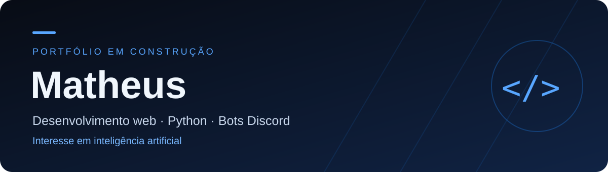

  

  <a href="https://github.com/cheioodafeemDeus?tab=repositories">Explorar repositórios</a>
  ·
  <a href="https://github.com/cheioodafeemDeus/Matheus">Repositório Matheus</a>

## Olá, eu sou o Matheus

Este é meu espaço para apresentar minha trajetória em tecnologia e organizar meu portfólio. Tenho interesse em **desenvolvimento web**, **Python**, **bots para Discord** e **inteligência artificial**.

Quero transformar ideias em soluções úteis e registrar aqui a evolução desse caminho.

## Áreas de interesse

| Área | O que quero explorar |
| :--- | :--- |
| **Desenvolvimento web** | Interfaces claras, páginas responsivas e aplicações para a web. |
| **Python** | Programação, scripts e automação de tarefas. |
| **Bots para Discord** | Comandos, integrações e recursos úteis para comunidades. |
| **Inteligência artificial** | Conceitos, ferramentas e possibilidades de aplicação em software. |

## Certificados

| Certificado | Instituição | Carga horária |
| :--- | :--- | :---: |
| **Ética na Inteligência Artificial** | SENAI São Paulo | 4 horas |
| **Competência Transversal - Lógica de Programação** | SENAI São Paulo | 14 horas |

## Meus repositórios

Explore meus repositórios para acompanhar o que compartilho no GitHub. O repositório [**Matheus**](https://github.com/cheioodafeemDeus/Matheus), que reúne esta apresentação.

---

  Matheus · <a href="https://github.com/cheioodafeemDeus">@cheioodafeemDeus</a>

